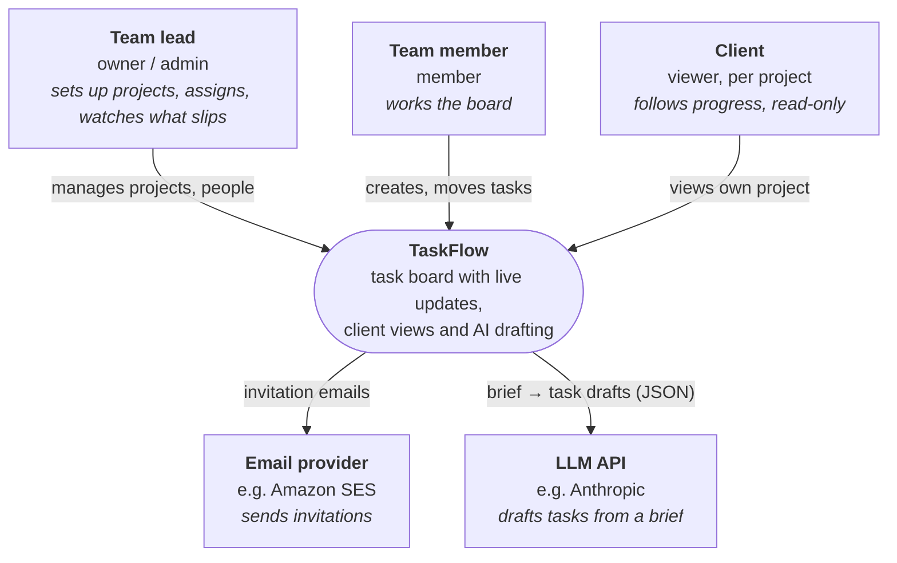
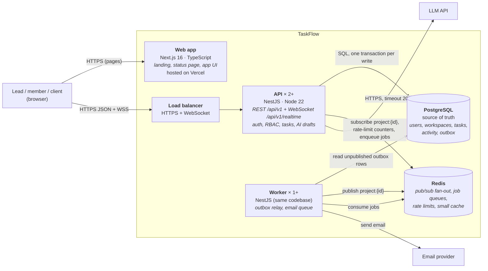

# C4 — Context and containers (v1)

Status: Stage 3 draft · 2026-10-26 · covers **all of v1** (PRD v1.3), including parts built after the backend core (queues, real LLM, deploy).

Inputs: ~20k users, ~35 requests/s at peak, ~4k concurrent WebSocket connections, 99.9% availability, strong consistency for task writes, strict tenant isolation (see `../README.md` → requirements).

## Level 1 — System context

Who uses TaskFlow, and which outside systems it depends on.

Out of the picture on purpose (non-goals): SSO, Slack/GitHub integrations, billing, file storage (attachments are v1.1).

## Level 2 — Containers

The deployable pieces inside TaskFlow and how they talk.

### What each container owns

| Container      | Tech                             | Owns                                                                                                                                                                      | Scales by                                                                                  |
| -------------- | -------------------------------- | ------------------------------------------------------------------------------------------------------------------------------------------------------------------------- | ------------------------------------------------------------------------------------------ |
| **Web app**    | Next.js on Vercel                | UI only; talks to the API with the OpenAPI-typed client. No database access.                                                                                              | Vercel's CDN                                                                               |
| **API**        | NestJS, Node 22                  | Every rule: authentication, roles, tenant isolation, optimistic locking (409), ordering, activity log, AI calls. REST and the WebSocket gateway live in the same process. | More instances behind the load balancer (stateless; sessions are JWTs)                     |
| **Worker**     | NestJS standalone app, same repo | Work that must not slow a request or must survive a crash: relaying the outbox to Redis, sending invitation emails with retries.                                          | More instances (jobs are claimed, not shared)                                              |
| **PostgreSQL** | Managed Postgres 16              | The only source of truth.                                                                                                                                                 | One primary is enough for 10× (see estimates); read replica only if Today queries get slow |
| **Redis**      | Managed Redis 7                  | Nothing that can't be rebuilt: pub/sub, queues (BullMQ), rate-limit counters, cached Today counts.                                                                        | One node; losing it delays events, never loses data                                        |

## The flows that shaped this

**1. A task moves (the core write).** Browser → `POST /tasks/{id}/move` → API checks the role, then in **one transaction**: `UPDATE tasks … WHERE id = $1 AND version = $2` (0 rows → 409), insert an `activity_events` row, insert an `outbox` row. Commit → 200 to the caller. The worker picks up the outbox row and publishes it on Redis channel `project:{id}`; every API instance with a socket subscribed to that project pushes it to its browsers. Target: < 1 s end to end.

**2. Live updates across instances.** Alice's socket is on API #1, Bob's on API #2. Without Redis, a write handled by #1 never reaches Bob. With pub/sub, every instance hears every project event and forwards it only to its own subscribers.

**3. Invitation email.** API writes the invitation and enqueues a job in the same request; the worker sends the email with retries and backoff. The API never waits for the email provider.

**4. AI drafting.** API checks the role and a per-workspace rate limit (Redis), calls the LLM synchronously (timeout 20 s, a request takes 2–8 s), validates the JSON against `TaskDraft`, returns drafts. Nothing is saved; only usage numbers are logged (no raw brief).

## Decisions (and what we gave up)

| Decision                                                                               | Why                                                                                                              | Trade-off accepted                                                                                   |
| -------------------------------------------------------------------------------------- | ---------------------------------------------------------------------------------------------------------------- | ---------------------------------------------------------------------------------------------------- |
| **Modular monolith** (one NestJS codebase → API + worker images)                       | One developer, ~35 req/s: microservices would add network calls, deploys and failure modes for no gain           | Modules must keep clean boundaries by discipline, not by network                                     |
| **WebSocket inside the API process**                                                   | 4k connections fit easily; one auth path, one deploy                                                             | A traffic spike in sockets competes with REST for CPU; split into a realtime service if that happens |
| **Transactional outbox** instead of publishing to Redis inside the request             | Publish-then-crash or rollback-after-publish would send events for changes that didn't happen, or lose real ones | Extra table + worker; events arrive ~100–300 ms later                                                |
| **Postgres as the only source of truth; Redis disposable**                             | Simple recovery story: restore Postgres, restart the rest                                                        | Every hot read still hits Postgres unless cached deliberately                                        |
| **Synchronous AI call** (not a background job)                                         | The user is waiting for the drafts anyway; a job + polling adds a lot for 2–8 s                                  | One slow LLM call holds a request; capped by timeout and rate limit                                  |
| **Stateless JWT access token (15 min) + rotating refresh token in an httpOnly cookie** | API instances don't share session state                                                                          | A stolen access token works until it expires (15 min); refresh reuse revokes the whole family        |

Deployment target (ADR-002, 28/10): Vercel for the web app; on AWS, containers for API and worker, managed Postgres and Redis, SES for email. Infrastructure as code follows once it runs.

## Open questions for the design review

1. Tenant isolation: application-level `workspace_id` filters only, or also Postgres row-level security as a second lock?
2. Do we need the cache at all in v1? (Estimates say Postgres handles the reads; the rate limiter needs Redis anyway.)
3. Realtime auth: the token is sent as the first socket message. What happens when it expires while the socket stays open?
