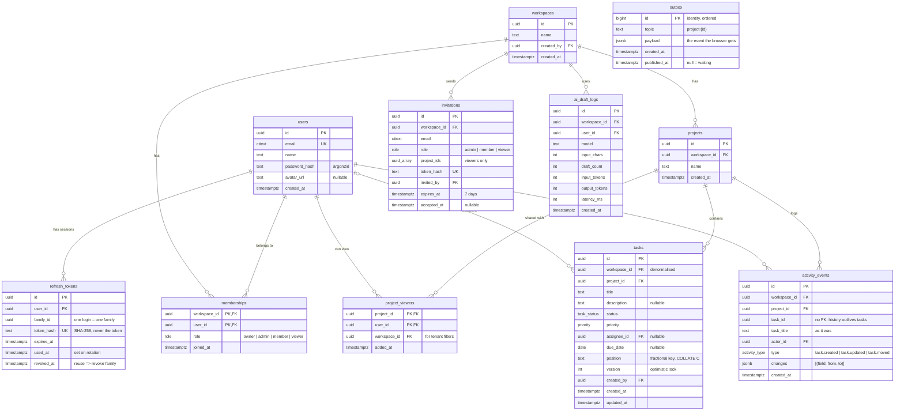

# Data model — ERD (v1)

Status: Stage 3 draft · 2026-10-26 · PostgreSQL 16. Every table the v1 API needs, including activity log, outbox and AI usage.

`outbox` has no relationships on purpose: it is a queue table, written in the same transaction as the change it announces.

## Indexes that carry the API

| Query (endpoint)                                                | Index                                                                | Why                                                                                      |
| --------------------------------------------------------------- | -------------------------------------------------------------------- | ---------------------------------------------------------------------------------------- |
| Board: tasks of a project in order (`GET /projects/{id}/tasks`) | `tasks (project_id, status, position, id)`                           | Matches the sort exactly; also the keyset cursor `(status, position, id)` for pagination |
| Today: late and due soon (`GET /workspaces/{id}/today`)         | `tasks (workspace_id, due_date) WHERE status <> 'done'`              | Partial index: done tasks (most of them, over time) are never scanned                    |
| My tasks / filters                                              | `tasks (assignee_id) WHERE assignee_id IS NOT NULL`                  | Assignee filter                                                                          |
| Activity tab (`GET /projects/{id}/activity`)                    | `activity_events (project_id, created_at DESC, id)`                  | Newest first + cursor                                                                    |
| Outbox relay                                                    | `outbox (id) WHERE published_at IS NULL`                             | The relay only ever reads the waiting rows                                               |
| Login                                                           | `users (email)` unique, `citext`                                     | Case-insensitive, one account per email                                                  |
| Refresh                                                         | `refresh_tokens (token_hash)` unique                                 | Lookup by hash                                                                           |
| Pending invite per email                                        | unique `invitations (workspace_id, email) WHERE accepted_at IS NULL` | "Already invited" (409) enforced by the database, not by a check-then-insert race        |

## Rules the schema enforces

1. **Tenant isolation:** every tenant row carries `workspace_id`; every query filters by the workspace the caller is a member of. Foreign keys stay inside one workspace (a task's project and assignee belong to the task's workspace; checked in the service, optionally by RLS).
2. **Optimistic locking:** writes are `UPDATE tasks SET …, version = version + 1 WHERE id = $1 AND version = $2`. Zero rows updated = 409 with the current row. One statement, so no race between check and write.
3. **Ordering:** `position` is a fractional-index string compared byte by byte, so the column uses `COLLATE "C"`. With a language collation, Postgres would sort `a0Z` and `a0a` differently from the client and the mock.
4. **Refresh tokens:** only the hash is stored. Using a token marks it `used_at` and issues the next one in the same family; presenting an already-used token revokes the whole family (likely theft).
5. **Viewers:** a `viewer` membership alone grants nothing; access to a project needs a `project_viewers` row. Owners, admins and members see every project in the workspace.
6. **History outlives data:** `activity_events.task_id` has no foreign key and keeps `task_title`, so deleting a task later doesn't erase who did what.
7. **Privacy for AI:** `ai_draft_logs` records usage and cost signals, never the client's brief.

## Deliberately not in v1

- `labels`: the API contract still returns `labels: []`; the table (or a `text[]` column) comes with labels in v1.1. To decide in the contract review: drop the field until then?
- `comments`, `attachments`, full-text search columns: v1.1 roadmap.
- Soft delete / archive: no delete endpoints in v1.
