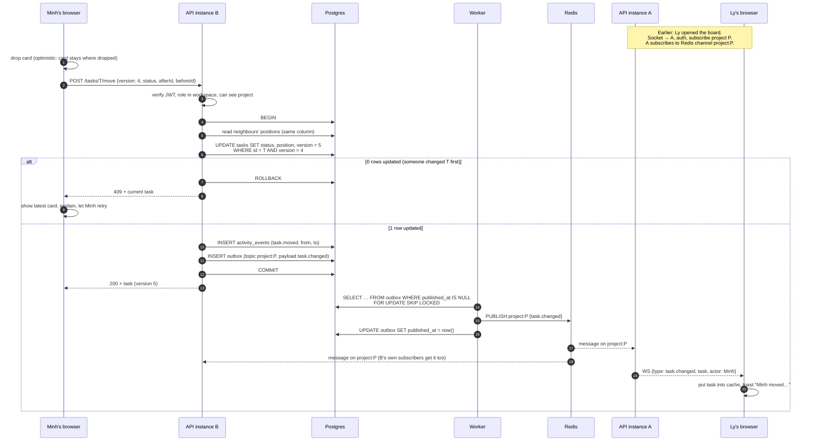
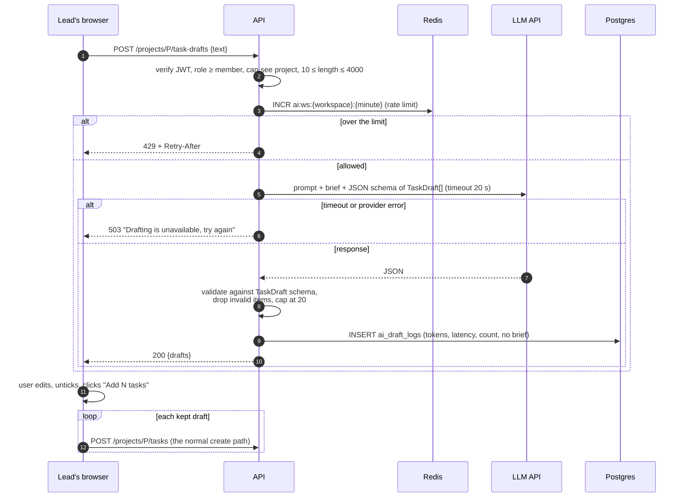
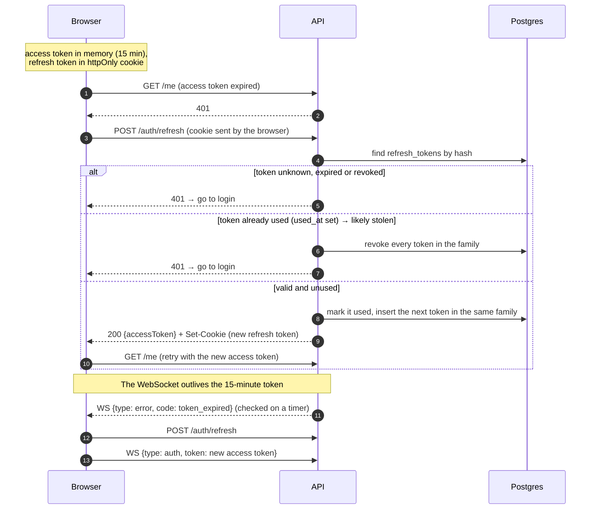

# Sequences — the three hard flows (v1)

Status: Stage 3 draft · 2026-10-28. Each diagram reads top to bottom in time. Containers are the ones in [01](01-context-and-containers.md); tables are in [02](02-data-model.md).

## 1. Moving a task, seen live by someone on another instance

Ly's browser holds a WebSocket to **API A**. Minh's request is routed to **API B**.

What to notice:

- **The 409 path never reaches Redis.** Nothing is announced unless the transaction commits; that is the job of the outbox: the activity row and the outbox row are written in the same transaction as the update.
- **The worker can crash between PUBLISH and the UPDATE.** Then the event is sent twice. Browsers handle that by comparing `version`: an event older than or equal to the cached version is ignored (idempotent apply).
- **`FOR UPDATE SKIP LOCKED`** lets two workers run without sending the same rows at the same moment.
- **Latency budget (< 1 s p95):** commit ~20 ms, worker poll ≤ 200 ms, Redis + socket ~10 ms.

## 2. Drafting tasks with AI

What to notice:

- **Nothing the model writes is saved directly.** It only becomes data through the normal, validated `createTask`, after a person approved it.
- **Two layers of protection for cost:** a per-workspace rate limit before the call, and a timeout during it.
- **Validation after the model**, not trust: a malformed or oversized answer is trimmed or rejected, never stored.
- **Privacy:** the log keeps numbers for cost and quality (tokens, latency, draft count), not the client's brief.

## 3. Staying logged in: refresh rotation and the open socket

What to notice:

- **Several tabs refreshing at once** would look like reuse. The client sends one refresh at a time per tab (a shared promise) and accepts a few seconds of grace for the token it just rotated.
- **The socket is re-authenticated, not trusted forever:** the server checks expiry on a timer and asks for a fresh token; a socket that doesn't answer is closed.

## Realtime messages (contract draft)

The WebSocket at `/api/v1/realtime` carries JSON messages. Types live in `apps/web/src/lib/realtime/protocol.ts` until they move into the contract package.

| Direction       | `type`         | Fields                                                                          | When                                                   |
| --------------- | -------------- | ------------------------------------------------------------------------------- | ------------------------------------------------------ |
| client → server | `auth`         | `token`                                                                         | first message, and after every refresh                 |
| client → server | `subscribe`    | `projectId`                                                                     | when a board opens (server checks the user can see it) |
| server → client | `presence`     | `projectId`, `users[]`                                                          | after subscribe, and when someone joins or leaves      |
| server → client | `task.changed` | `projectId`, `change` (`created`, `moved`, `updated`), `task`, `actor`, `from?` | every committed task write, via the outbox             |
| server → client | `error`        | `code`: `unauthorized`, `not_found`, `token_expired`                            | the client refreshes or leaves the project             |

Changes compared with the prototype: `change: "updated"` (edits from the task drawer) and `error: "token_expired"` are new in this design.
